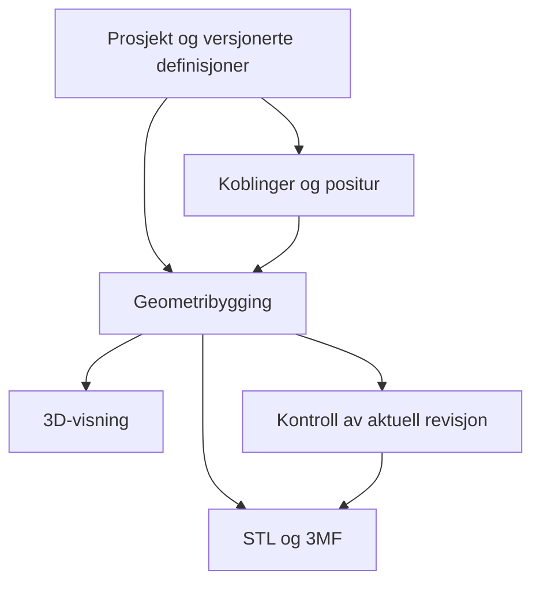

# Dragon Forge – et modulært verksted for artikulerte, 3D-printbare drager

Prosjektavhandling, utviklingsoppskrift og arbeidsordre til Claude  
For Sivert Hovde / Designporten  
Dato: 2. november 2026 · Versjon 1.0

## 1. Prosjektets hovedidé

Dragon Forge skal la brukeren bygge en drage ved å plassere og kombinere artikulerte brikker i et tredimensjonalt byggebord. Brikkene skal kunne redigeres, gjentas, byttes ut og lagres som presets. Koblingene skal ha en egen designer, slik at utseendet på en drage og mekanikken i leddene kan utvikles hver for seg og deretter kontrolleres sammen.

Det sentrale er overføringen av CityKit-prinsippet: Et modellregister definerer hvilke deler som finnes, en parametrisk motor bygger delene, et byggebord setter dem sammen, og eksporten bruker de samme delene som visningen. Forskjellen er at Dragon Forge organiserer deler rundt ledd, bevegelse og kroppskjeder. CityKit organiserer bygningsdeler rundt standardiserte mål og monteringsforbindelser.

Brukeren skal kunne starte med en ferdig drage, endre antall kroppsledd, velge andre hoder og haler, plassere bein og vinger, forme en egen kroppsbrikke og lagre resultatet som en ny modellfamilie. Den avanserte brukeren skal også kunne designe forbindelser og lage egne brikkebiblioteker. Dette er to dybder i samme verktøy, med samme prosjektformat og samme geometrikilde.

En vellykket løsning er ikke bare en drage som ser riktig ut på skjermen. Den digitale modellen, eksportfilen, printretningen og den fysiske forbindelsen må henge sammen. Derfor behandles produksjon som en del av konstruksjonen helt fra første brikke.

## 2. Hva som er bekreftet, og hva dette dokumentet foreslår

Siverts nye bestilling er å lage Dragon Forge med en CityKit-lignende arbeidsmåte: plassere artikulerte brikker, redigere brikker, lage presets og ha en koblingsdesigner. Dette er prosjektets nye retning. De konkrete grensesnittene, datastrukturene og implementeringsfasene nedenfor er et samlet løsningsforslag til denne bestillingen, ikke en påstand om at funksjonene allerede finnes.

Følgende kilder er gjennomgått:

- CityKit-pakken `CityKit_komplett_samtaleoppsummering.zip`, særlig `SAMLET_OPPSUMMERING.md`, `TIL_CLAUDE.md` og `LES_MEG_FØRST.txt`.
- `AGENTS.md`, `CLAUDE.md`, `DESIGNPORTEN_MASTER.md`, `docs/development.md` og `docs/overlevering-codex.md` i `sihovd/designporten-v2`.
- Dragon Forge-delen av `docs/design/skaperverksted.md`.
- `src/skaperverksted/generatorer/drage/index.ts` og `kjerne.ts`.
- Offisiell dokumentasjon for Three.js, Manifold og 3MF, oppført i kildekapitlet.

CityKit-oppsummeringen bekrefter modellregister, parametrisk motor, standardiserte brikker og kravet om samsvar mellom digitalt bygg og printbare deler. Den gir ikke en komplett, verifisert beskrivelse av CityKit-koden. Denne avhandlingen forutsetter derfor ikke at en bestemt CityKit-klasse eller komponent kan kopieres direkte.

Dragon Forge er registrert som generatoren `drage` i Designportens Skaperverksted. Den undersøkte kjernen oppretter et dokument med parameterverdier og kaller `byggDrageModell`. Den eksisterende UI-tilkoblingen har delvelger, inspektør og et 3D-overlegg. Kjernen bruker merket «Foreløpige dragedeler (utviklingsgeometri)». Dette er konkrete kodeobservasjoner; ingen kjøring av appen eller fysisk test er gjennomført som del av avhandlingen.

Den eldre Dragon Forge-spesifikasjonen beskriver hovedsakelig ferdigmodellerte deler med faste leddpunkter. Siverts nye ønske om brikkeredigering og koblingsdesigner utvider denne modellen. Claude må registrere utvidelsen i spesifikasjon og beslutningslogg før implementeringen avviker fra den tidligere beskrivelsen.

## 3. Avgrensning mot de andre Forge-verktøyene

Dragon Forge skal ha et tydelig fokus på modulære drager og beslektede kroppskjeder. Creature Forge beholder sin selvstendige arbeidsflyt for friere formbygging, splines og overflateverktøy. BuildForge og funksjoner rundt tastaturswitcher skal ikke trekkes inn som produktinnhold i denne oppgaven.

Den tidligere isolerte kjettingleddtesten fra Creature Forge kan være en relevant mekanisk referanse. Den er ikke i seg selv dokumentasjon på at Dragon Forge skal låses til den mekanismen. Koblingsdesigneren skal kunne beskrive mekaniske familier, men første produksjonsrettede familie må velges ut fra faktisk eksisterende Dragon Forge-geometri og testbare prøver.

Felles, rene hjelpefunksjoner for transformasjoner, historikk eller eksport kan gjenbrukes etter kodegjennomgang. Produktmodellene skal ikke blandes sammen som en snarvei. Ingen endringer i CityKit, Creature Forge, BuildForge, Sign Forge eller Form Forge inngår i denne prosjektbestillingen.

## 4. CityKit-prinsippet oversatt til Dragon Forge

| CityKit-prinsipp | Dragon Forge-prinsipp | Praktisk konsekvens |
|---|---|---|
| Modellregister for standarddeler | Register for dragebrikker og koblingsprofiler | Alle deler har stabil identitet og versjon |
| Byggebord med moduler | Byggebord med leddkjeder og forgreninger | Brukeren bygger i kontekst, ikke bare i skjemaer |
| Standardisert modulgeometri | Standardiserte mekaniske grensesnitt | Nye uttrykk skal passe til avtalte koblinger |
| Egenskaper for en plassert del | Lokale egenskaper for en brikkeinstans | Én brikke kan endres uten at alle endres |
| Parametriske modellfamilier | Parametriske kropps-, hode- og halefamilier | Variasjon skjer med eksplisitte parametere |
| Digital del og eksportdel samsvarer | Samme bygde geometri i 3D og eksport | Ingen separat, enklere eksportmodell |
| Monteringsrekkefølge | Monteringsmåte og leddfangst | Ettermontert og print-in-place skilles |
| Printretning som konstruksjonskrav | Leddorientering og byggeplatekontakt som krav | Dekor får ikke gjøre mekanikken uprintbar |

CityKit-lærdommen er ikke å gi en drage et vegg- eller veirutenett. Den er å gjøre modellen forståelig som et system av navngitte deler med en felles kontrakt. Et rutenett er nyttig på byggeplaten, mens et koblingspunkt er viktigere når et bein festes til en kropp.

## 5. Fire arbeidsrom i samme prosjekt

Arbeidet deles i fire tydelige rom: Bygg drage, Rediger brikke, Design kobling og Klargjør print. Overgangen mellom dem skal bevare utvalg, historikk og sammenheng. En bruker som åpner en kroppsbrikke fra dragen, skal komme tilbake til samme drage og samme valgte brikke.

**Bygg drage** er hovedrommet. Her plasseres deler, kroppskjeder forlenges, presets settes inn og posituren justeres. Brukeren trenger ikke se detaljer om triangulering eller beregningsmotor.

**Rediger brikke** viser én brikke med resten av dragen nedtonet. Her endres grunnform, proporsjoner, dekor, fargesoner og koblingspunkter. Vernesoner rundt mekanikken er synlige når en endring nærmer seg dem.

**Design kobling** viser to enkle prøvebrikker med en valgt mekanisme mellom dem. Her undersøkes klaring, feste, fangst, orientering og bevegelse uten at horn og skjell skjuler problemet.

**Klargjør print** viser en egen printkonfigurasjon, byggeplate, kontroller og eksport. Visningsposituren skal ikke endres i det skjulte når modellen plasseres for produksjon.

## 6. Hovedarbeidsflyten fra tomt prosjekt til drage

En ny bruker velger «Ny drage» eller et lagret preset. En tom drage starter med en hovedbrikke som gir et forståelig sentrum. Biblioteket tilbyr hoder, halsledd, kropp, hale, bein, vinger og dekor. Brukeren kan enten dra inn en brikke eller velge brikken og deretter trykke på et kompatibelt koblingspunkt.

Når en del nærmer seg et passende punkt, vises en forhåndsvisning. Den viser hvilken ende som brukes, hvordan brikken orienteres, og hvilken sammenkobling som vil bli opprettet. Før brukeren slipper, kan delens alternative tilkoblingspunkt velges. Slippet er én samlet handling i historikken.

Brukeren kan deretter sette inn flere kroppsledd, avsmalne halen, bytte hode og plassere parvise bein. En valgt brikke har raske handlinger: Rediger, Bytt, Dupliser, Speil, Koble fra og Lag preset. En forbindelse har egne handlinger: Vis kobling, Endre profil og Prøv bevegelse.

Når dragen er ferdig, lagres prosjektet med redigerbare parametere og referanser. Deretter velges printkonfigurasjon og kontroller kjøres mot den aktuelle revisjonen. Eksporten beholder separate bevegelige legemer. Godkjent skjermplassering erstatter ikke en mekanisk kontroll.

## 7. Brikkebiblioteket og modellregisteret

En biblioteksbrikke er en definisjon, ikke bare en meshfil. Den skal beskrive identitet, kategori, parametere, geometrioppskrift, koblingspunkter, vernesoner, materialsoner, avhengigheter og status. En importert mesh kan inngå i definisjonen, men har bare de redigeringsmulighetene som faktisk er tilgjengelige for den kilden.

Registeret må skille mellom tre nivåer:

1. **Brikkedefinisjon:** En bestemt versjon av en deltype, for eksempel «Kroppsledd, avrundet».
2. **Brikkeinstans:** Én plassert forekomst med egne parameterverdier og eventuell lokal dekor.
3. **Bygd geometri:** Det beregnede resultatet som brukes til visning, kontroll og eksport.

Det skal være mulig å finne hvilke prosjekter som bruker en bestemt definisjon. En oppdatering av «Kroppsledd, avrundet» må ikke endre eldre prosjekter uten en uttrykkelig oppdateringshandling. Et prosjekt åpnes med den versjonen det ble lagret med, eller med en innebygd kopi som gjør prosjektet selvstendig.

Biblioteket bør kunne filtreres etter kategori, koblingsfamilie, størrelseklasse og valideringsstatus. Småbilder genereres fra den faktiske brikken, slik at biblioteket ikke viser en illustrasjon som avviker fra modellen brukeren får.

## 8. Plassering og snapping

Snapping er editorens forslag om hvor en del skal settes. Det betyr ikke at delene har fysiske magneter. Et koblingspunkt inneholder en lokal posisjon og et komplett orienteringssystem: en utretning, en oppretning og en definert nullrotasjon.

Ved plassering beregnes kildepunktets posisjon i verden og målpunktets posisjon i verden. Kandidater filtreres først etter familie, rolle, kapasitet og versjon. Deretter rangeres de etter avstand og vinkel. Systemet må ha en stabil terskel for å beholde en valgt kandidat, slik at forhåndsvisningen ikke hopper mellom to punkter når fingeren beveger seg litt.

For vanlige kontaktbaserte forbindelser kan plasseringen uttrykkes som:

`T_barn = T_forelder · K_forelder · M_kobling(q) · invers(K_barn)`

Her er `K` koblingsrammene i hver brikkes lokale koordinater, og `M_kobling(q)` profilens definerte mating og leddstilling. Rotasjons- og avstandsreglene skal ligge i profilen. De skal ikke spres som spesialtilfeller i UI-koden.

Et kjettingledd krever en egen relativ transformasjon som gir faktisk innfletting. To løkkers sentre skal ikke bare legges oppå hverandre som om de var plugg og hull. Formelen kan fortsatt brukes som kontrakt, men mekanismeprofilen må levere riktig `M_kobling`.

Ledige og opptatte punkter må skilles både visuelt og med tekst. Brukeren skal kunne velge et punkt fra en liste hvis det ligger bak modellen. Det skal også være mulig å legge en del løst på platen uten å opprette en forbindelse.

## 9. Sammenkoblingsgraf og modelltre

Prosjektets sannhet er en graf av brikkeinstanser og forbindelser. Et modelltre er en visning som gjør denne grafen lett å navigere. Det er ikke tilstrekkelig å lagre alt som nestede Three.js-objekter, fordi visningshierarkiet og den mekaniske strukturen har ulike oppgaver.

Første versjon bør støtte et rotfestet tre per sammenhengende gruppe. Det gir kroppskjede, hode, hale og forgreninger til bein og vinger, uten å kreve en generell solver for lukkede mekaniske sløyfer. Løse grupper er tillatt og vises som egne grupper. Forsøk på å lukke en strukturell sløyfe avvises med forklaring i denne versjonen.

Hvert koblingspunkt har som standard kapasitet én. Sletting og frakobling må ha eksplisitt virkning: Koble fra bevarer brikkene i nåværende verdensposisjon og lager en løs gruppe. Slett brikke skal gi valg mellom å bevare avhengige deler som løse grupper eller å slette den markerte grenen. Utført handling kan angres samlet.

Ved bytte av en brikke brukes stabile koblingsroller til å finne tilsvarende punkter på den nye brikken. Hvis den nye brikken mangler et nødvendig punkt, vises konsekvensene før byttet. Barn skal aldri flyttes til tilfeldige punkter bare fordi de ligger nærmest.

## 10. Kroppskjeder og gjentatte brikker

En drage trenger en rask måte å bygge mange kroppsledd på. Kjedefunksjonen skal la brukeren velge en brikkefamilie, antall, størrelsesforløp og eventuell bane. Kjeden består fortsatt av identifiserbare brikker og forbindelser. Den skal ikke bli ett sammenhengende rør uten artikulasjon.

Det bør finnes en tydelig forskjell mellom «Gjenta som lenkede instanser» og «Lag uavhengige kopier». Lenkede instanser følger en valgt definisjon, mens lokale overstyringer bevares. En kjede skal også kunne løses opp til vanlig redigerbare brikker uten at plassering og koblinger endres.

Antallsendring må være forutsigbar. Økes antallet, settes nye ledd inn i et valgt område. Reduseres antallet, viser verktøyet hvilke brikker og sidegrener som påvirkes. Unike bein, vinger eller dekorasjoner skal ikke slettes som en utilsiktet følge av et tallfelt.

En avsmalnende hale skal kunne få gradvis mindre dekorativ kropp, men mekaniske grensesnitt må enten beholde kompatibel størrelse eller bruke en uttrykkelig overgangsbrikke. Å skalere hele hver instans er ikke en trygg standardstrategi.

## 11. Baner og positur

En redigerbar bane kan brukes til å legge en kroppskjede i en bue eller S-form. Brikkene må fordeles etter faktisk kjedelengde og leddbegrensninger. En spline er her en plasseringshjelp for en artikulert kjede. Den er ikke en erstatning for brikkenes geometri eller koblingskontrakter.

Hvis banen krever mer bøy enn leddene tillater, skal verktøyet vise området som ikke kan oppfylles. Det må ikke tøye koblingene, strekke brikkene eller la dem gli fra hverandre for å få et pent bilde. Første versjon kan støtte enkle planlagte baner før fri romlig kurveføring.

Prosjektet skal skille mellom redigeringspositur, demonstrasjonspositur og printpositur. Alle tre refererer til samme deler. Printposituren må i tillegg overholde mekanisk sammenheng og produksjonskrav. Visningsanimasjon skal være merket som demonstrasjon når det ikke finnes en fysisk solver.

## 12. Brikkeeditoren

Brikkeeditoren åpnes fra en valgt brikke og viser tydelig hva som redigeres: «Kun denne brikken», «Utvalgte brikker» eller «Brikkedefinisjonen». Standardvalget bør være lokal endring, slik at en liten justering ikke overraskende endrer hele dragen.

Editoren skal ha et strukturtre med grunnform, positive former, negative former, dekor, fargesoner og koblingspunkter. Negativ form markeres med en egen rolle og et synlig merke i listen. Rollen er en geometrisk operasjon, ikke bare en mørkere visningsfarge.

Første nyttige formsett er avrundet kropp, ellipsoide, avsmalnende kropp og en begrenset profilbasert kropp. Brukeren endrer lengde, bredde, høyde og formprofil, og kan legge til for eksempel horn, ryggpigger, øyne eller skjell. Eksisterende ferdigmodellerte deler skal fortsatt kunne brukes.

Ikke-destruktiv redigering betyr at oppskriften bevares. En brikke skal kunne gjenoppbygges etter at en parameter endres. Hvis brukeren gjør en operasjon som bare kan lagres som en frosset mesh, må det være en eksplisitt konvertering med forklaring om hvilke parametere som ikke lenger kan redigeres.

Mekanikkens vernesoner skal være en del av editorens kontrakt. Brukeren kan ikke male over en bevegelig åpning uten å få et konkret funn. «Tillat avansert overstyring» kan eventuelt finnes som en prøvefunksjon, men resultatet skal da miste den tidligere mekaniske valideringsstatusen.

## 13. Direkte manipulering og overflatedetaljer

Utseendet skal kunne endres med håndtak på modellen i tillegg til tallfelter. Lengde, bredde og høyde får tydelige håndtak. Hvis en brikkefamilie bruker profilringer, kan ringen dras for å endre tverrsnittet. Dette er en brikkeparameter; mekaniske ender skal ikke automatisk skaleres sammen med ringens dekorative form.

Detaljer som plasseres på overflaten må ha en definert forankring. En forankring kan være knyttet til den parametriske kroppens koordinater og en lokal orientering. En ren referanse til trekant nummer 238 er for skjør hvis en parameterendring bygger hele meshen på nytt.

Når underlaget endres, beregnes detaljens plassering fra forankringen. Klarer systemet ikke å finne et gyldig underlag, skal detaljen markeres som uforankret. Den skal ikke forsvinne eller hoppe til en vilkårlig del av modellen.

Et avansert overflateverktøy kan senere lage et strøk med bredde, tykkelse og avstand fra underlaget. For Dragon Forge er første behov å plassere og gjenta dragedetaljer på en stabil måte. Et fullstendig malebasert meshverktøy bør ikke være en avhengighet for første fungerende brikkebygger.

## 14. Koblingsdesigneren som eget verksted

Koblingsdesigneren skal åpne en liten testscene med to enkle legemer og mekanismen mellom dem. Brukeren velger familie, justerer tillatte parametere, ser et snitt og prøver definerte leddstillinger. Mekanikkens forståelighet er viktigere enn en dekorativ dragepresentasjon i dette rommet.

Designeren skal behandle fire forskjellige ting:

1. **Editorpunktet:** Hvor brukeren kan feste en brikke digitalt.
2. **Mekanismen:** Den faktiske geometrien som forbinder de bevegelige legemene.
3. **Frivolumet:** Området som må være ledig under bevegelse og montering.
4. **Forankringen:** Materialet som binder mekanismen til resten av brikken.

En koblingsprofil skal derfor inneholde mer enn diameter og klaring. Den trenger koordinatkonvensjon, dimensjoner, kompatibilitet, monteringsmåte, bevegelighetsbeskrivelse, vernesoner og teststatus. Alle mekaniske mål lagres i millimeter. Vinkler har eksplisitt enhet og fortegn.

Brukeren bør kunne se partnerdelen gjennomsiktig, skjule hver halvdel, slå på snittplan og vise mål. Testscenen skal ha samme geometri som profilens bruk i en drage. En egen «pen illustrasjon» av leddet er ikke tilstrekkelig.

## 15. Mekanismefamilier og førstevalg

Arkitekturen bør kunne beskrive flere mekanismefamilier, men første implementering skal velge én familie og gjøre den ordentlig. Dette dokumentet fastsetter ikke produksjonsmål eller én endelig familie uten å ha undersøkt den faktiske geometrien.

| Familie | Funksjon | Viktigste forhold som må dokumenteres |
|---|---|---|
| Innflettede lukkede løkker | Løs, artikulert forbindelse | Faktisk innfletting, klaring, fangst og supportforhold |
| Hengsel med fanget aksling | Hovedsakelig rotasjon rundt én akse | Aksling, lagerflater, aksial klaring og frigjøring etter print |
| Ettermontert kuleledd | Flere rotasjonsretninger | Innsettingsvei, materialdeformasjon, halsstyrke og retensjon |
| Ettermontert plugg-/svivelledd | Enkel montert rotasjon | Innfesting, slitasje, friksjon og demontering |

Disse familiene er et foreslått framtidig register, ikke fire samtidige MVP-løfter. Ettermontert kuleledd og print-in-place-kuleledd skal være ulike profiler fordi produksjon og fangst er forskjellige.

Det tidligere ønsket om en skråstilt løkke er relevant ved vurdering av kjettingledd. Skråstillingen må være en parameter i profilens produksjonsgeometri, med tydelig referanse til brikkens og byggeplatens koordinater. Den skal ikke bare være en kameravinkel som får et problematisk ledd til å se bedre ut.

## 16. To løkker som faktisk er lenket

Hvis første mekanisme blir kjettingledd, må to betingelser kontrolleres hver for seg: Løkkene skal ikke overlappe fysisk, og de skal være innflettet slik at forbindelsen ikke kan trekkes fra hverandre uten at en løkke åpnes eller går gjennom den andre.

En avstandstest kan ikke bevise innfletting. To ringer kan ligge tett og likevel være fullstendig løse. En 90-graders rotasjon beviser heller ikke at de er lenket. Testene må undersøke geometrien som helhet.

For en enkel, orientert løkkefamilie kan en kontroll av senterlinjenes lenking inngå i den digitale valideringen, sammen med kontroll av at de er lukkede og at de faktiske, tykke legemene er adskilt. En slik metode må implementeres med dokumentert numerisk toleranse og kjente kontrolltilfeller. Den skal ikke gjenbrukes ukritisk på selvkryssende eller helt andre mekanismefamilier.

Minst fire testtilfeller kreves: korrekt lenket par, to frie ringer, kolliderende ringer og nesten berørende ringer. Bevegelsestest skal i tillegg kontrollere at forankringene mot kroppene ikke støter sammen før løkkene når sin planlagte bevegelighet.

## 17. Klaringer, skalering og kalibrering

Klaring må ha en entydig definisjon. I et sirkulært aksel/hull-par betyr radial klaring avstanden mellom flatene på én side. Diametral klaring er forskjellen mellom hulldiameter og akseldiameter. For dette enkle tilfellet er diametral klaring to ganger radial klaring. UI-et skal si hvilken verdi brukeren redigerer.

For vilkårlige løkker og avrundede flater bør klaringskravet defineres som minste tillatte overflateavstand i den aktuelle konfigurasjonen. Kvaliteten på avstandsberegningen og geometrisk tilnærming skal være kjent. Et tall med flere desimaler er ikke bevis på en nøyaktig beregning.

Det finnes ingen universell produksjonsklaring som dokumentet kan godkjenne på forhånd. Printer, materiale, dyse, laghøyde, første lag, orientering og lokal geometri kan påvirke resultatet. Parametrene skal derfor komme fra navngitte prøveprofiler og senere fra dokumenterte testprint.

En kalibreringsserie kan eksempelvis undersøke 0,30, 0,40, 0,50 og 0,60 mm nominell overflateavstand. Dette er et foreslått prøveoppsett, ikke et løfte om at intervallet virker. Testbrikkene merkes med profilversjon og nominell klaring, og resultatet registreres sammen med printer- og slicerinnstillinger.

Skalering deles i tre brukerhandlinger: Endre uttrykk, Bytt mekanisk størrelse og Skaler hele prøven. Den første endrer kroppen med mekanikken låst. Den andre velger kompatible mekaniske størrelser i hele berørt gruppe. Den tredje er en avansert handling som gjør tidligere fysiske testresultater uanvendelige til ny geometri er undersøkt.

## 18. Vernesoner og fysisk sammenheng

Hvert ledd skal ha et forankringsvolum der mekanikken må ha tilstrekkelig forbindelse til brikken, og et frivolum der partnerdelen eller mekanismen skal kunne bevege seg. Dekor og negative operasjoner vurderes mot begge.

En ryggpigg som ligger i partnerens bevegelsesrom gir et bevegelsesproblem. En negativ form som skjærer gjennom løkkens feste gir et forankringsproblem. Disse skal ha forskjellige regel-ID-er og forklaringer. Det hjelper ikke å oppgi bare «ugyldig mesh» når brukeren trenger å vite hva som må flyttes.

Dekor kan slås sammen med sin egen kropp når det skal bli én fysisk del. To bevegelige nabobrikkers geometri må ikke slås sammen for å få en enklere eksport. Strukturelt skal systemet vite hvilke skall som tilhører samme legeme, hvilke som skal være bevegelige, og hvilke som bare er separate fargesoner.

Et legeme som ser samlet ut på skjermen kan bestå av løse skall. Kontrollen må derfor undersøke den produserte geometrien og forankringen. Et rendret overlapp eller et Three.js-parentforhold er ikke i seg selv en fysisk sammenføyning.

## 19. Presets som redigerbare oppskrifter

Et preset skal lagre en oppskrift som kan redigeres videre. Det skal ikke bare være et skjermbilde eller en frosset STL. Fire presettyper foreslås:

| Type | Innhold | Eksempel |
|---|---|---|
| Brikkepreset | Definisjon, parametere, dekor og koblingspunkter | Avrundet kroppsledd med tre ryggpigger |
| Koblingspreset | Mekanisme, dimensjoner, grenser og teststatus | En bestemt versjon av et løkkeledd |
| Gruppepreset | Flere brikker, forbindelser og eksterne koblingspunkter | Beinpar med hoftefester |
| Dragepreset | Hele oppskriften og valgt startpositur | Lang drage med kort hals og avsmalnende hale |

Et gruppepreset må deklarere hvilke koblingspunkter som er åpne ut mot resten av modellen. Når gruppen settes inn, opprettes nye instans-ID-er, mens interne forbindelser peker til de nye ID-ene. Ellers kan to innsettinger av samme preset feilaktig kobles sammen gjennom gjenbrukte identifikatorer.

Et preset har navn, beskrivelse, kategori, versjon, opphav, avhengigheter og generert forhåndsvisning. Prosjektet bør kunne inneholde de nødvendige definisjonene, slik at en eksportert prosjektfil kan åpnes selv om biblioteket senere endres. Lisensopplysninger for importerte modeller skal følge med når de finnes; manglende bruksrett skal ikke omskrives til en automatisk fri lisens.

Når brukeren lagrer et lokalt preset, blir det tilgjengelig i biblioteket. Det skal ikke automatisk publiseres eller deles. Skybibliotek og kontolagring kobles til eksisterende kontokontrakt etter at prosjektformatet er på plass. Før det skal lokal lagring og filnedlasting fungere som reelle funksjoner.

## 20. Global og lokal redigering

Brukeren må alltid vite hvor langt en endring rekker. Hvis ti ledd bruker samme definisjon, skal «Rediger kun denne» lage en lokal overstyring eller en egen definisjon for den forekomsten. «Oppdater alle som bruker denne» viser hvilke instanser i det åpne prosjektet som blir berørt.

Oppdatering av selve biblioteket er en tredje handling. Den lager en ny definisjonsversjon og må ikke tvinge oppdateringen inn i andre prosjekter. Dermed kan Sivert forbedre en brikke uten at gamle modeller mister geometrien de ble godkjent med.

Ved oppdatering sammenlignes parameteroppsett og koblingspunkter. Stabile ID-er bevares hvis betydningen er den samme. Fjernede punkter, endret mekanismefamilie og endret størrelseklasse utløser en konsekvensoversikt. Systemet skal ikke gjette at en forbindelse fortsatt passer fordi navnet ligner.

Presets og lokale overstyringer må også fungere sammen: En lokal fargeendring skal kunne beholdes når en ny brikkedefinisjon tas inn, mens et endret koblingspunkt kan kreve ny kontroll. Disse forskjellene må være eksplisitte i oppdateringslogikken.

## 21. Brukergrensesnitt på stor skjerm

På stor skjerm skal dragen være hovedinnholdet. Øverst ligger prosjektnavn, angre/gjør om, lagring, arbeidsrom og eksport. Venstre panel har Bibliotek og Modell. Høyre panel viser egenskapene til utvalget. Nedre kant kan ha et kompakt område for kjedeparametere eller presetvalg når dette er relevant.

Bibliotekets kategorier bør svare til brukerens oppgave: Hoder, Hals, Kropp, Hale, Bein, Vinger, Detaljer og Mine presets. Koblingsprofiler har et eget område i koblingsdesigneren og presenteres ikke som vanlige pyntebrikker.

Modellpanelet viser hovedkropp, leddkjede, sidegrener og løse grupper. Et valgt ledd i listen markeres på modellen. Et valgt ledd på modellen ruller listen til riktig rad. En forbindelse kan velges uten at hele brikken velges, for eksempel gjennom et synlig koblingsmerke eller forbindelseslisten i egenskaper.

Fargebruk skal følge eksisterende tokens: lilla for utvalg, cyan for måling og snapping, og tekst/symboler i tillegg til statusfarge. Ved konflikt mellom eldre detaljdokumenter og masterspesifikasjonen følger typografi og identitet masteren. Nye hardkodede stiler skal ikke etableres som et parallelt designsystem.

Det skal ikke være nødvendig å fylle skjermen med alle avanserte kontroller. En ny bruker kan velge brikke og koblingspunkt. Avanserte parametere åpnes i riktig kontekst, uten at prosjektet gjøres om til en annen type dokument.

## 22. Mobil og iPad

På mobil skal 3D-visningen fylle hoveddelen av skjermen. Bibliotek og egenskaper åpnes som nedre skuffer. Når et punkt ligger bak modellen, skal punktlisten være en likeverdig måte å koble på. Ingen nødvendig funksjon skal avhenge av høyreklikk, hover eller en presis dra-og-slipp-bevegelse.

Den enkleste monteringsflyten er: Velg del i biblioteket, trykk på en fremhevet kobling, bekreft plasseringen. Alternativt velger brukeren koblingen først og får opp kompatible deler. Begge retninger reduserer behovet for å dra et lite objekt over en full skjerm.

Navigasjon skal ha en tydelig aktiv modus. Én finger manipulerer valgt håndtak eller roterer visningen når ingen håndtak er aktivert. To fingre brukes til panorering og zoom etter en konsekvent regel som prøves på fysisk enhet. Lange trykk kan åpne en meny, men vanlige knapper må gi samme tilgang.

Tallfelt skal være store nok til berøring, og enhet skal stå synlig. Endringer i en skuff skal fortsatt vise den berørte delen av dragen. Når tastaturet åpnes, skal ikke bekreftelsesknappen bli utilgjengelig under det. Mobiltest må omfatte faktisk Safari på iPhone/iPad, ikke bare et smalt skrivebordsvindu.

## 23. Datamodellen

Prosjektformatet skal være serialiserbart, versjonert og uavhengig av rendermotoren. Forslaget nedenfor er en domeneoversikt, ikke en påstand om eksisterende TypeScript-typer:

| Entitet | Nødvendige opplysninger |
|---|---|
| Prosjekt | Skjemaversjon, ID, navn, revisjon, enhet, definisjoner, instanser, forbindelser, grupper, positurer og printoppsett |
| Brikkedefinisjon | ID, versjon, kategori, parameterkontrakt, geometrioppskrift, punkter, soner og kildeinformasjon |
| Brikkeinstans | ID, definisjonsreferanse, parametere, lokale overstyringer, materialvalg og gruppetilhørighet |
| Koblingspunkt | Stabil ID, lokal ramme, rolle, kompatibilitetskrav og kapasitet |
| Koblingsprofil | ID, versjon, mekanismefamilie, dimensjoner, mating, bevegelsesmodell, frivolum og teststatus |
| Forbindelse | To instans-/punktreferanser, profilreferanse, leddtilstand og produksjonsmåte |
| Gruppe | ID, medlemskap, rot og plassering for løs eller samlet gruppe |
| Positur | Navngitte leddtilstander og gruppeplasseringer |
| Kontrollresultat | Prosjektrevisjon, geometriversjon, profilversjoner, regel-ID-er, funn, metode og toleranser |
| Preset | Type, oppskrift, avhengigheter, versjon og innsettingspunkter |

Definisjoner og mekaniske profiler er innhold med egne versjoner. Skjemaversjon beskriver filformatet. Disse må ikke blandes: Et nytt filformat er noe annet enn en ny versjon av en hale eller et ledd.

Ved import valideres tall, grenser, referanser, ID-er, kapasitet, kompatibilitet og grafstruktur. Ukjent mekanikkversjon skal gi et konkret problem. En migrering må bevare originalen og gi et kontrollerbart resultat, ikke stille erstatte en ukjent profil med dagens standard.

Prosjektfilen skal ikke kreve Three.js-objekter, funksjoner eller aktive nettverksforbindelser for å beskrive dragen. Meshcacher kan slettes og gjenoppbygges uten at brukerens design går tapt.

## 24. Teknisk arkitektur i Designporten

Utgangspunktet er den verifiserte arkitekturen i `designporten-v2`: Astro, Preact der UI-et trenger det, en rammeverksuavhengig TypeScript-kjerne og Three.js for 3D. Ny funksjonalitet skal først undersøke og gjenbruke det eksisterende generatorskallet, historikken, enhetene og eksportkontraktene.

Dragon Forge skal fortsatt registreres som `drage`. Et nytt internt prosjektformat kan ligge i generatorens egne parametere eller i en eksplisitt utvidelse av dokumentkontrakten etter kodegjennomgang. Det skal ikke etableres en ny offentlig rute eller en konkurrerende app-ID som bryter eksisterende lenker uten at dette er nødvendig og dokumentert.

En hensiktsmessig intern oppdeling er prosjektmodell, bibliotek, brikkebygging, koblinger, plassering, validering, presets, import/eksport og UI. Filnavn og kodeidentifikatorer følger repoets norske ASCII-konvensjon. Oppdelingen er et ansvarskart; Claude må tilpasse konkrete filer til den faktiske strukturen.

Geometribyggingen produserer identifiserbare legemer med materialsoner og metadata. Både eksport og kontroll bruker dette resultatet. Renderlaget kan ha enklere visningsgeometri under drag, men en lavoppløst visningsmesh skal ikke uten videre bli eksportert som endelig modell.

Three.js håndterer transformasjoner og visning, men er ikke en produksjonsgaranti. Manifold er en mulig kandidat for robuste meshoperasjoner hvis prosjektet mangler egnet løsning. Bibliotekvalg avgjøres etter en avgrenset prøve med de aktuelle brikkene, ikke ved å innføre en ny motor før eksisterende geometri er undersøkt.

## 25. Geometrikvalitet og adaptiv oppløsning

Polygonantall skal bestemmes av geometrisk feil, ikke ett globalt «kvalitetstall» alene. Langs en buet profil kan oppdelingen økes der en grov tilnærming gir for stort avvik, mens rette områder trenger færre segmenter. Tilsvarende må et lite ledd få nok oppløsning til at klaringen ikke forsvinner i en grov polygonisering.

En skarp kant skal representeres med en riktig kant og riktige flater. Det er ikke alltid nyttig å legge mange trekanter tett rundt en matematisk knekk. Ved avrundinger, overgangsradier og komplekse kutt må oppløsningen derimot følge tillatt feil. Brukeren bør få forståelige valg som Forhåndsvisning og Eksportkvalitet, mens motoren håndterer lokale behov.

Hvis en overflate tilnærmes med en maksimal posisjonsfeil, må klaringskontrollen ta denne feilen med i vurderingen. To tilnærmede flater kan begge avvike. Det skal derfor ikke rapporteres en sikker passning når den forventede marginen er mindre enn beregningens usikkerhet.

Vernesoner kan bruke konservative volum i tidlige kontroller. Endelig kontroll må undersøke den produserte geometrien med en oppgitt metode. Enkle bokser er nyttige for å finne kandidater, men de gir ikke tilstrekkelig svar på minsteavstanden mellom to skrå løkker.

## 26. Bevegelse og kollisjonskontroll

Koblingsprofilen beskriver tillatte leddtilstander. Et hengsel kan bruke én vinkel, mens en løs løkkeforbindelse krever en annen og mer kompleks bevegelsesbeskrivelse. Den første implementeringen skal ikke late som alle mekanismer er kuleledd med tre frie rotasjoner.

«Prøv bevegelse» må oppgi hva som kontrolleres: bare partnerbrikkene, hele dragen i utvalgte stillinger eller et konservativt bevegelsesvolum. En animasjon som går gjennom ti stillinger beviser ikke at det ikke finnes en kollisjon mellom dem. Hvis testen er diskret, vises den som en kontroll av de undersøkte stillingene.

Kontroll av hele dragen må inkludere naboer uten direkte forbindelse, for eksempel hale mot vinge og horn mot hals. Det kan innføres i en senere fase enn lokal leddkontroll, men grensesnittet må vise forskjellen fra første dag.

Resultater trenger både alvorlighetsgrad og evidensnivå. «Geometrisk kollisjon funnet» kan være en blokkering. «Bevegelsesområde bare delvis undersøkt» er en begrensning. «Fysisk testet med profil X» er dokumentasjon av et bestemt oppsett, ikke en generell garanti for alle materialer og størrelser.

## 27. Printoppsett og byggeplate

Printoppsettet er en lagret konfigurasjon med byggeplate, orientering og plassering. For ettermonterte deler kan brikkene organiseres separat. For en print-in-place-drage må hele den sammenhengende mekaniske gruppen behandles som en enhet med interne frirom bevart.

Man skal ikke bruke automatisk plassering til å spre innflettede løkker utover platen som uavhengige deler. Det ødelegger forbindelsen. Tilsvarende kan man ikke senke hver enkelt brikke til Z = 0 uten å undersøke hva det gjør med leddet mellom dem.

Printkontrollen undersøker byggevolum, avstand mellom legemer, kontakt mot platen, løse øyer, tynne områder og aktuelle overheng. En enkel overhengsvinkel er bare en geometrisk indikator. Den skal ikke alene gi merket «supportfri» eller «ferdig validert».

Et hensiktsmessig testløp er først to koblingsbrikker, deretter tre kroppsledd med virkelig kropp, og til slutt en liten komplett drage. Første lag og innvendige løkkepartier undersøkes i slicer. Deretter dokumenteres frigjøring, bevegelse og eventuelle brudd etter fysisk print.

## 28. Eksport og samsvar med modellen

Prosjektformat, STL og 3MF har forskjellige roller. Prosjektfilen bevarer oppskriften. STL leverer geometri uten den samme strukturen for farger og prosjektdata. 3MF skal brukes når enheter, objektstruktur og materialinformasjon skal følge med innenfor støtten i eksportør og mottaker.

En bevegelig drage må eksporteres med separate legemer selv om den er ett samlet print. Fargesoner innenfor et legeme må modelleres og skrives uten å ødelegge den fysiske sammenhengen. At en fil inneholder farger betyr ikke automatisk at alle slicere velger riktige AMS-plasser eller filamenter.

Eksporten skal bruke den ferdig bygde modellen for en bestemt revisjon. Hvis brukeren endrer dragen mens eksport bygges, må den fullføre en konsistent tidligere revisjon med tydelig identitet eller avbrytes og startes på nytt. Den skal ikke blande gamle og nye brikker.

En kontrollrapport bør følge eksporten. Den angir prosjekt- og profilversjoner, måleenhet, hvilke legemer som er med, geometrisk status, mekaniske begrensninger og fysisk teststatus. Klare geometrifeil blokkerer vanlig produksjonseksport. Utestede prøveprofiler kan eksporteres gjennom en uttrykkelig prøveeksport med rapport, slik at kalibrering faktisk er mulig.

Eksportfilen må åpnes i en relevant slicer og sammenlignes med appen. Kontroll av filstruktur og tall er nødvendig, men erstatter ikke kontroll av hvordan mottakeren tolker komponenter, plassering og materialer.

## 29. Lagring, historikk og ytelse

Hver meningsfull brukerhandling skal kunne angres som én handling. Et sammenhengende drag kan gi mange forhåndsvisninger, men skal bare gi ett historikksteg. Å sette inn et gruppepreset skal kunne angres med alle dets brikker og forbindelser samlet.

Prosjektdata og grensesnittoppsett lagres hver for seg. Panelbredde og kameravinkel skal ikke gjøre en mekanisk profil til en ny versjon. Omvendt skal endring av klaring markere aktuelle kontrollresultater som foreldet med én gang.

Tung geometri og kontroller bør kjøres uten å blokkere brukergrensesnittet, med eksplisitt revisjons-ID i hver jobb. Et gammelt svar skal ikke overskrive resultatet fra en nyere redigering. Under beregning skal status være «Beregner» eller «Resultat foreldet», ikke grønn fra forrige modell.

Like brikker kan dele visningsgeometri når alle geometriavhengige parametere er like. Materialvariasjon og instanstransformasjon trenger ikke alltid ny mesh. Derimot må lokal dekor, negativ form eller ny mekanikk gi en annen cacheidentitet. Cachen må inkludere definisjons- og profilversjon.

Automatisk lokal gjenoppretting skal bevare en redigerbar oppskrift. Hvis lagringsplassen er full, vises en konkret feil med mulighet til filnedlasting. Ingen lagringsknapp skal vise «Lagret» uten et vellykket resultat.

## 30. Utviklingsoppskrift, fase for fase

### Fase 0 – kartlegg og avtal kontraktene

Claude leser de faktiske prosjektreglene og kartlegger Dragon Forge, relevante delbiblioteker og CityKit-koden dersom den er tilgjengelig. Leveransen er en kort oversikt over hva som finnes, hva som gjenbrukes, hvilke dokumenter som må oppdateres, og hvilke produksjonsmål som mangler.

Spesifikasjonen oppdateres med den nye retningen. Ukjente mål merkes som ukjente eller prøveverdier. Ingen påstand om en eksisterende, fysisk testet mekanikk skal innføres uten dokumentasjon.

### Fase 1 – byggbar graf og plasserbare brikker

Innfør instanser, punkter, forbindelser og ett rotfestet tre per gruppe. La brukeren sette inn et hode, flere kroppsledd og en hale, flytte grupper, koble fra og angre. Start med eksisterende brikker eller tydelig merkede utviklingsbrikker.

Fasen er ferdig når den lagrede prosjektfilen kan åpnes igjen med samme brikker, forbindelser og plassering, og en ugyldig forbindelse ikke blir opprettet.

### Fase 2 – brikkeeditor med lokale endringer

Gjør én kroppsbrikkefamilie parametrisk. Legg til kontrollert grunnform, positiv/negativ form, dekor og synlige vernesoner. Skill mellom lokal endring og definisjonsendring. Bevar eksisterende ferdigdeler som bibliotekinnhold.

Fasen er ferdig når én av flere like brikker kan få et eget uttrykk uten at de andre endres, og når samme oppskrift gir samme eksportgeometri.

### Fase 3 – koblingsdesigner med én mekanisme

Velg én familie etter gjennomgang av reell mekanikk. Implementer en tobrikketest, relevante parametere, snitt, kompatibilitet, klaringskontroll og prøveeksport. Dokumenter hvilke bevegelser som er kontrollert.

Fasen er digitalt ferdig når testtilfellene skiller lenking, kollisjon og frie deler riktig. Fysisk bekreftelse er en separat milepæl etter slicing og prøveprint. De to statusene skal aldri slås sammen.

### Fase 4 – presets og bibliotek

Innfør lokale brikke-, gruppe-, koblings- og dragepresets med versjonerte avhengigheter. Implementer innsetting med nye instans-ID-er, søk og genererte småbilder. Et preset kan eksporteres og importeres uten å miste redigerbarheten.

Fasen er ferdig når et gruppepreset kan settes inn to ganger uten krysskoblinger, og et gammelt prosjekt åpnes uendret etter en bibliotekoppdatering.

### Fase 5 – kjeder, par og kontrollerte baner

Legg til gjentatte kroppsledd, gradvis formvariasjon, avsmalning, speilpar og enkle baner. Legg inn konsekvensoversikt ved antallsendring og kompatible overganger ved endret mekanisk størrelse.

Fasen er ferdig når brukeren kan bygge en lang drage uten manuell plassering av hvert ledd, og umulig bøy blir forklart uten at mekanikken strekkes eller overlapper.

### Fase 6 – produksjonskonfigurasjon og kontrollert eksport

Skill positur fra printoppsett, bevar print-in-place-grupper, gjenbruk felles eksport der den støtter kravene, og legg til kontrollrapport. Verifiser i slicer og prøv fysisk i stigende kompleksitet.

Fasen er ferdig når en navngitt testmodell kan spores fra prosjektfil til eksport og testprint, med kjente begrensninger registrert. En avansert full drage er ikke nødvendig for å bevise det første, reelle leddsystemet.

## 31. Akseptansekriterier Claude skal teste mot

| ID | Situasjon | Forventet resultat |
|---|---|---|
| DF-01 | En kompatibel brikke plasseres ved et ledig punkt | Riktig punkt og orientering vises før forbindelsen opprettes |
| DF-02 | Et opptatt eller inkompatibelt punkt velges | Ingen forbindelse opprettes; årsaken forklares |
| DF-03 | Én brikke i en serie redigeres lokalt | Bare den instansen endres |
| DF-04 | En ny definisjonsversjon lagres | Eldre prosjekter beholder sin versjon |
| DF-05 | En brikke med sidegren erstattes | Kompatible forbindelser bevares; tap av forbindelser vises før utføring |
| DF-06 | Et preset settes inn to ganger | Instans-ID-er er unike og interne koblinger er riktige |
| DF-07 | Prosjekt eksporteres og importeres | Parametere, profiler, forbindelser og positurer bevares |
| DF-08 | Kroppens bredde endres med låst mekanikk | Koblingsmål og klaring endres ikke utilsiktet |
| DF-09 | En negativ form treffer leddets forankring | Et konkret forankringsfunn vises |
| DF-10 | To frie løkker ligger nær hverandre | De godkjennes ikke som lenket bare på grunn av nærhet |
| DF-11 | Geometrien overlapper mellom bevegelige legemer | Produksjonseksport blokkeres med synlig funn |
| DF-12 | Ny redigering skjer under en geometriberegning | Gammelt resultat vises ikke som kontroll av ny revisjon |
| DF-13 | En print-in-place-gruppe organiseres på platen | Den indre mekaniske sammenhengen beholdes |
| DF-14 | Brukeren kobler fra og angrer | Hele opprinnelige forbindelsen og plasseringen gjenopprettes |
| DF-15 | Dragen bygges med berøring | Bibliotek, punktvalg, redigering og eksport kan fullføres uten hover |
| DF-16 | 3MF åpnes i slicer | Størrelse, legemer, plassering og støttede materialdata samsvarer |
| DF-17 | Antall ledd reduseres ved en unik sidegren | Konsekvensene vises; sidegrenen slettes ikke i det skjulte |
| DF-18 | En fysisk testprofil brukes med andre mål | Tidligere teststatus arves ikke ukritisk |

De automatiske testene bør særlig dekke graf, referanser, transformasjoner, migrering, klaringsdefinisjoner og eksport. Interaksjon testes med målrettede brukerflyter. Fysisk funksjon dokumenteres gjennom faktisk prøveprint. Antall tester alene er ikke et kvalitetsmål.

## 32. En konkret første drage som referanseprosjekt

Første sammenhengende referanseprosjekt bør bestå av ett hode, tre kroppsledd og én hale. Det er lite nok til at hver forbindelse kan undersøkes, men stort nok til å vise om systemet fungerer som en modulær dragebygger.

Brukeren plasserer leddene på byggebordet, kobler dem i en kjede og endrer bredden på midterste kroppsledd. Mekanikken beholdes. Deretter lagres kroppsleddet som eget preset, en kopi settes inn, og antallet ledd oppdateres. Til slutt byttes hodet med en kompatibel variant.

Dette prosjektet skal lagres, lukkes og åpnes igjen. Det skal eksporteres som redigerbar prosjektfil og produksjonsgeometri. Kontrollrapporten skal vise nøyaktig hvilke mekaniske profiler som brukes. Hvis første leddfamilie er utestet, er prosjektet en digital referanse og prøveprintkandidat inntil det foreligger fysisk resultat.

Beinpar, vinger, store dekorbiblioteker og avansert kroppsbane legges til etter at denne gjennomgående flyten virker. Formålet er å bevise hele kjeden fra brukerhandling til fysisk forbindelse før innholdsmengden økes.

## 33. Overgang fra dagens Dragon Forge

Det undersøkte pluginet og kjernen må bevares som utgangspunkt. Claude må først lese `bygg.ts`, `parametre.ts`, relevante tester og eksportkontrakter for å fastslå hva som faktisk fungerer. Disse filene er ikke analysert i denne avhandlingen, og den eksisterende geometrien skal derfor ikke beskrives som teknisk godkjent eller avskrives uten videre undersøkelse.

Det gamle parameterformatet beskriver valg som lengde, kropp, hode, horn, pigger, hale, vinger, mønster og farger. En migrering må bevare disse valgene og oversette dem til brikker eller lagrede oppskrifter der det er mulig. Hvis en tidligere visuell variant ikke har en ferdig brikkedefinisjon, må den fortsatt kunne åpnes i kompatibel modus fremfor å bli erstattet av et annet uttrykk.

Revisjoner skal innføres trinnvis på en arbeidsgren. Eksisterende rute, delvalg, lagring og ordrehåndtering undersøkes for regresjoner. At denne avhandlingen foreslår mekaniske kontroller, gir ikke grunnlag for å omskrive handel eller andre generatorer.

Repoets eksisterende `delerOverlapper: true` må undersøkes spesielt når modellen får flere bevegelige legemer. Dekor som overlapper sin egen kropp kan være tilsiktet, mens overlapp mellom to ledd er en feil. En global tillatelse må ikke gjøre at denne forskjellen forsvinner fra kontrollene.

## 34. Uavklarte spørsmål og hvordan de håndteres

Følgende punkter er reelle avklaringer, ikke grunnlag for å stanse all planlegging:

- Hvor CityKits nåværende kildekode og modellregister ligger, hvis direkte kodegjenbruk ønskes. Den undersøkte overleveringspakken er ikke selve appkoden.
- Hvilke Dragon Forge-deler som er endelige produksjonsmodeller, og hvilke som bare er utviklingsgeometri.
- Hvilken mekanismefamilie som velges først, og om den allerede har dokumenterte prøveprint.
- Faktiske mekaniske dimensjoner, materialer og printeroppsett for første kalibrering.
- Om brikkepresets i første omgang skal være lokale alene eller også kobles til kontosystemet etter prosjektformatfasen.

Claude kan undersøke tilgjengelig kode, definere datakontrakter, bygge den digitale plasseringsflyten og lage eksplisitt merkede prøveprofiler uten å finne på produksjonsgodkjenning. Hvis et valg krever ukjent fysisk mål, skal bare den berørte delen av arbeidet avvente avklaring.

## 35. Ferdig arbeidsordre til Claude

Følgende er overleveringsinstruksen som skal følge dokumentet når det åpnes i riktig Claude-prosjekt:

> Videreutvikle Dragon Forge etter denne prosjektavhandlingen. Sivert ønsker en CityKit-lignende arbeidsflyt med plasserbare artikulerte brikker, brikkeeditor, presets og koblingsdesigner. Bruk dokumentet som ny produktretning og et konkret implementeringsforslag. Skill mellom bekreftede eksisterende forhold og foreslåtte løsninger.
>
> Start med å lese prosjektets AGENTS.md, CLAUDE.md, autoritative masterspesifikasjon og relevante Dragon Forge-filer. Kartlegg den faktiske koden før du velger hva som skal gjenbrukes. Registrer den nye retningen i spesifikasjonen og beslutningsloggen. Bevar fungerende deler, eksisterende prosjektdata og offentlige lenker.
>
> Arbeid isolert med Dragon Forge. Endre ikke CityKit, Creature Forge, BuildForge, Sign Forge eller Form Forge som del av oppgaven. Delte moduler endres bare der det er nødvendig og med avgrensede, kompatible endringer. Følg repoets navnekonvensjoner og designsystem.
>
> Første leveranse er fase 0 og fase 1: en kartlegging og en fungerende grafbasert brikkebygger. Bruk den lille referansedragen fra kapittel 32. La brukeren plassere, koble, koble fra, bytte, lagre, åpne og angre uten tap av data. Ikke stopp ved et UI-konsept eller knapper uten implementert funksjon.
>
> Utvid deretter etter faseplanen: lokal brikkeredigering, én reell koblingsfamilie, presets, kjeder og produksjonskonfigurasjon. Gjenbruk eksisterende geometri der den oppfyller kontrakten. Ikke innfør en ny geometrimotor før behovet er dokumentert gjennom en konkret prøve.
>
> Skill digitale snappunkter fra fysisk leddgeometri. Bevar mekaniske mål ved dekorativ skalering. Dersom kjettingledd velges, kontroller både faktisk lenking og fravær av geometrisk overlapp. Ikke velg tilfeldige klaringer som ferdige produksjonsmål. Utestet mekanikk merkes som prøveprofil.
>
> Gjør visning, kontroll og eksport avhengige av samme revisjon og geometrikilde. Bevar separate bevegelige legemer. Et rødt geometrifunn blokkerer vanlig produksjonseksport; kalibreringsfiler må kunne leveres som tydelig merket prøveeksport.
>
> Kjør relevante kontroller og brukerflyter. Rapporter konkret hva som er implementert, hva som er testet, hva som ikke er implementert, og hvilke spørsmål som faktisk blokkerer neste del. Ikke kall løsningen fysisk validert før prøveprint er dokumentert. Arbeid på gren og følg repoets PR-regler; ikke push direkte til main eller publiser produksjon.

Denne arbeidsordren er klargjort for Claude. Dokumentets opprettelse er ikke bevis på at det er sendt eller lest i en Claude-økt.

## 36. Kilder og sporbarhet

### Interne kilder

**CityKit:** `CityKit_komplett_samtaleoppsummering.zip`, datert 30. oktober 2026. Tekstfilene i pakken er gjennomgått. Den inkluderer også bilder, en tidligere UX-PDF og originale printfiler. Disse vedleggene er ikke behandlet som verifisert kode eller fysisk validerte løsninger i denne avhandlingen, og er ikke endret.

**Designporten-regler:** [AGENTS.md](https://github.com/sihovd/designporten-v2/blob/main/AGENTS.md), [CLAUDE.md](https://github.com/sihovd/designporten-v2/blob/main/CLAUDE.md), [masterspesifikasjon](https://github.com/sihovd/designporten-v2/blob/main/DESIGNPORTEN_MASTER.md), [utviklingsdokumentasjon](https://github.com/sihovd/designporten-v2/blob/main/docs/development.md) og [overlevering](https://github.com/sihovd/designporten-v2/blob/main/docs/overlevering-codex.md), lest 2. november 2026. Overleveringen har historisk status; nye kodeobservasjoner og prosjektets kildehierarki må veie tyngre ved implementering.

**Dragon Forge:** [Skaperverksted-spesifikasjon](https://github.com/sihovd/designporten-v2/blob/main/docs/design/skaperverksted.md), [plugin](https://github.com/sihovd/designporten-v2/blob/main/src/skaperverksted/generatorer/drage/index.ts) og [kjerne](https://github.com/sihovd/designporten-v2/blob/main/src/skaperverksted/generatorer/drage/kjerne.ts), lest fra standardgrenen 2. november 2026. Lest kjerne hadde blob-SHA `2d67ed918ff089d5144e9ccee3ae8d727c4d3364`; plugin hadde `9f3125665858cf2351c62c6afc5b80be36982343`. Dette gir en referanse til observasjonene, ikke en påstand om hele repoets status.

### Eksterne primærkilder

- [Three.js – Object3D](https://threejs.org/docs/pages/Object3D.html): referanse for lokale rammer, verdenstransformasjoner og scenehierarki.
- [Manifold – prosjektets dokumentasjon](https://manifoldcad.org/docs/html/): grunnlag for å vurdere biblioteket som kandidat for solide meshoperasjoner.
- [3MF Consortium – spesifikasjoner](https://3mf.io/spec/) og [Core Specification](https://github.com/3MFConsortium/spec_core/blob/master/3MF%20Core%20Specification.md): referanse for enheter, komponenter og strukturert produksjonsutveksling.

Datamodell, faseplan, editoratferd, mekaniske vernesoner og akseptansekriterier i denne avhandlingen er prosjektforslag utarbeidet for Siverts bestilling. De eksterne kildene dokumenterer tekniske byggeklosser, ikke at Dragon Forge allerede oppfyller kravene.
